# Dashboard GIS

Dashboard GIS untuk memantau dan mengelola aset jaringan **Tiang** dan **ONT** berbasis peta. Dibangun dengan Laravel & Inertia + React + Leaflet, mendukung manajemen per wilayah, foto aset, dan notifikasi aktivitas.

## Dokumentasi

- [Panduan Penggunaan Aplikasi](docs/panduan-penggunaan-aplikasi.md)
- [Panduan Pengelolaan Data Aset](docs/panduan-pengelolaan-data-aset.md)
- [Panduan Penggunaan Peta Sebaran Aset](docs/panduan-peta-sebaran-aset.md)
- [Panduan Pengaturan Wilayah Operasi](docs/panduan-wilayah-operasi.md)
- [Panduan Notifikasi dan Rekapitulasi](docs/panduan-notifikasi-rekapitulasi.md)
- [Dokumentasi Teknis Sistem](docs/dokumentasi-teknis-sistem.md)

## Prasyarat

- **PHP 8.2** + ekstensi `gd`, `mbstring`, `pdo_mysql`, `fileinfo`, `openssl`
- **Composer 2.x**
- **Node.js 20+** & **npm 9+**
- **MySQL**
- **Git**

## Panduan Instalasi

### 1. Clone Proyek

```bash
git clone https://github.com/Magang-VAS/dashboard-gis.git dashboard-gis

cd dashboard-gis
```

### 2. Instal Dependensi

```bash
composer install
npm install
```

### 3. Konfigurasi Environment

```bash
cp .env.example .env
# Windows (XAMPP): copy .env.example .env
php artisan key:generate
```

Buka file `.env` lalu sesuaikan dengan device:

```env
APP_URL=http://localhost
# Jika dijalankan via XAMPP subfolder htdocs:
# APP_URL=http://localhost/dashboard-gis

DB_CONNECTION=mysql
DB_HOST=127.0.0.1
DB_PORT=3306
DB_DATABASE=gis_database
DB_USERNAME=root
DB_PASSWORD=

SESSION_DRIVER=file
CACHE_STORE=database
FILESYSTEM_DISK=local
```

> `APP_URL` subfolder sudah ditangani otomatis via `resolveHref` di frontend, tidak perlu konfigurasi tambahan.

### 4. Siapkan Database

Buat database `gis_database` via phpMyAdmin atau CLI:

```bash
mysql -u root -e "CREATE DATABASE gis_database CHARACTER SET utf8mb4 COLLATE utf8mb4_unicode_ci;"
```

Lalu migrasi dan symlink storage:

```bash
php artisan migrate --seed
php artisan storage:link
```

Pastikan folder writable:

```bash
# Linux / macOS
chown -R $USER:daemon dashboard-gis

chmod -R 775 dashboard-gis

chmod -R 775 storage bootstrap/cache
```

Foto pada data contoh menggunakan path `tiang/dummy.jpg` dan `ont/dummy.jpg` (string placeholder, tidak memerlukan file fisik).

### 5. Setup Konfigurasi Wilayah Operasi

```bash
php artisan settings:generate

cd storage/app

chmod 775 settings.json

chown $USER:daemon settings.json
```

settings.json digunakan sebagai konfigurasi dinamis untuk wilayah operasi

### 6. Build Frontend

Untuk produksi:

```bash
npm run build
```

Hasil build akan ada di `public/build`. Untuk pengembangan:

```bash
npm run dev
```

### 7. Jalankan Aplikasi

**Opsi A — via Composer (disarankan):**

```bash
composer run dev
```

Perintah ini menjalankan `php artisan serve` + `queue:listen` + `pail` + `vite` secara bersamaan.

**Opsi B — Manual (terminal terpisah):**

```bash
php artisan serve
# Akses: http://localhost:8000/home
# Jika via XAMPP htdocs: http://localhost/dashboard-gis/home

# Terminal lain:
npm run dev
```

### 8. Login & Verifikasi

Akun default dari seeder:

- **Username:** `admin`
- **Password:** `password`

Setelah login, verifikasi:

- Buka `/home` — 4 kartu statistik (TOTAL TIANG, TOTAL ONT, WILAYAH COVERAGE, DATA BERKOORDINAT) harus menampilkan angka dari database, bukan `9999`.
- Peta tampil jika wilayah sudah dipilih di `/pengaturan` (default `sleman` jika sudah seed & `storage/app/settings.json` terisi). Jika belum, akan muncul ajakan "Wilayah Belum Ditentukan".
- Buka `/data-tiang` dan `/data-ont` — tabel paginasi 15 baris, foto dummy, filter wilayah/status berfungsi.
- Buka `/wilayah` — harus ada 8 baris wilayah beserta total aset.
- Buka `/peta-sebaran-aset` — filter Tiang/ONT, status, dan wilayah berfungsi; marker sesuai bbox tiap wilayah.

### 9. Fitur Utama

- **Dashboard & Rekapitulasi** — statistik live Tiang/ONT (Aktif/Nonaktif), cakupan wilayah, % berkoordinat, peta pratinjau wilayah operasi, dan 5 pembaruan aset terbaru.
- **Data Tiang, ONT & Wilayah** — tabel paginasi + filter + pencarian dengan aksi Detail/Edit/Hapus; rekap per wilayah; hapus wilayah ditolak bila masih punya aset.
- **Formulir Aset** — kode otomatis (`SIMS-kode-nomor`), autocomplete kecamatan/kelurahan, koordinat via klik peta atau pencarian alamat, 5 foto (otomatis WebP; bisa diganti/dikosongkan per slot saat ubah).
- **Peta Sebaran Aset** — filter jenis/status/wilayah, marker hijau (Aktif) dan merah (Nonaktif), popup + tautan detail, tombol Google Maps, dan koordinat kursor live.
- **Ekspor & Pencarian** — unduh PDF/Excel mengikuti filter aktif (cakupan halaman ini atau semua data); pencarian global di header (min. 2 huruf).
- **Notifikasi** — audit trail tiap CRUD dan permintaan reset akun, status baca otomatis, serta tombol tandai semua dibaca dan hapus yang dibaca.
- **Pengaturan & Akun** — wilayah operasi (`settings.json`), profil dan reset kata sandi via persetujuan admin, tema Terang/Gelap per perangkat, login sesi + Ingat Saya 30 hari + Lupa Password; konversi foto via `cwebp`/ImageMagick (lihat `config/image.php`).

### 10. Dokumentasi Antarmuka

Bagian ini menampilkan dokumentasi antarmuka **GIS Dashboard** untuk pengelolaan dan pemantauan aset jaringan Tiang dan ONT.

### Screenshots

### Login

Halaman login digunakan untuk melakukan autentikasi pengguna sebelum mengakses sistem GIS Dashboard.

<p align="center">
  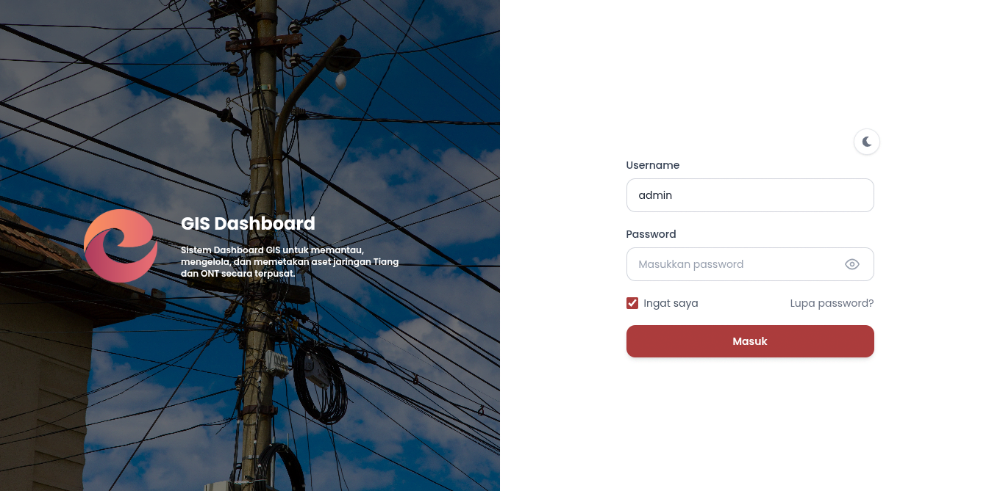
</p>

---

### Home

Halaman Home merupakan halaman utama setelah pengguna berhasil login. Halaman ini menampilkan ringkasan data aset Tiang serta informasi status aset.

<p align="center">
  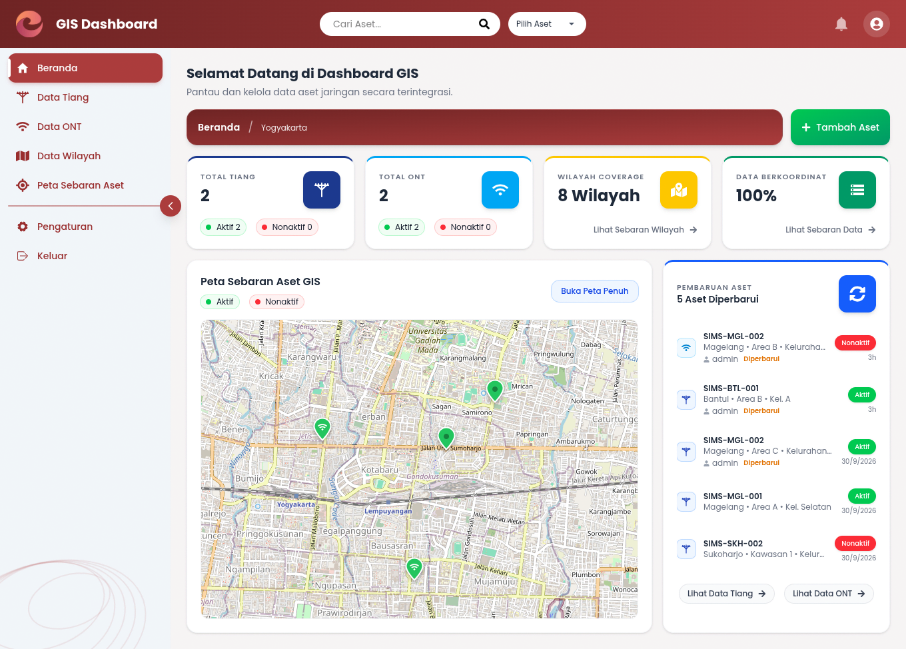
</p>

---

### Data Tiang

Halaman Data Tiang digunakan untuk melihat dan mengelola data aset Tiang yang tersimpan di dalam sistem. Pengguna dapat melihat informasi Tiang, melakukan pencarian atau penyaringan data, serta mengakses detail dan fungsi pengelolaan data.

<p align="center">
  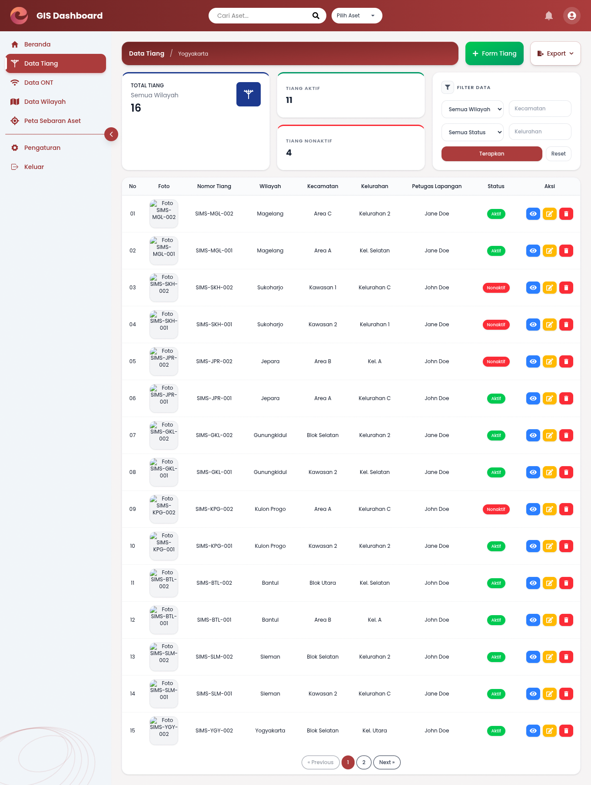
</p>

---

### Data ONT

Halaman Data ONT digunakan untuk menampilkan dan mengelola data perangkat ONT yang terdaftar pada sistem.

<p align="center">
  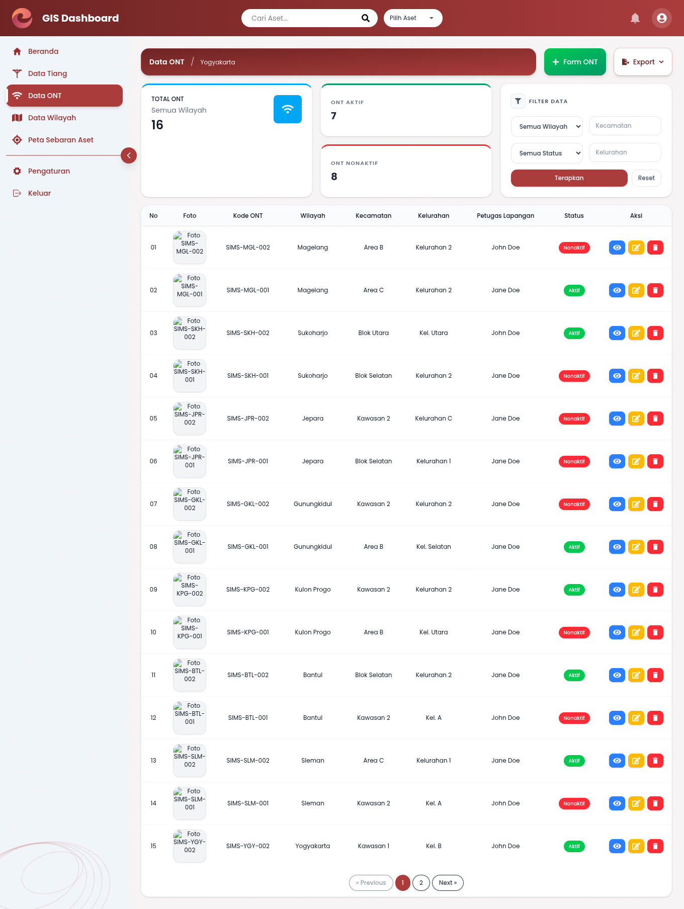
</p>

---

### Data Wilayah

Halaman Data Wilayah digunakan untuk mengelola daftar wilayah yang digunakan sebagai bagian dari pengelompokan dan pengelolaan aset jaringan.

<p align="center">
  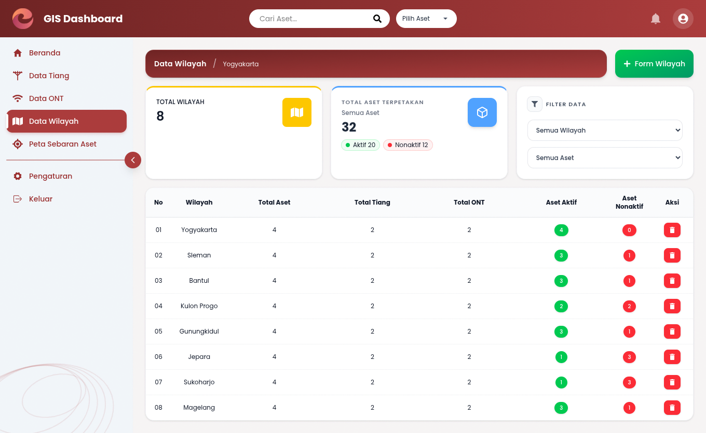
</p>

---

### Peta Sebaran Aset

Halaman Peta Sebaran Aset digunakan untuk menampilkan persebaran aset jaringan secara geografis. Data aset dapat ditampilkan berdasarkan wilayah dan jenis aset sehingga memudahkan pemantauan lokasi Tiang dan ONT.

<p align="center">
  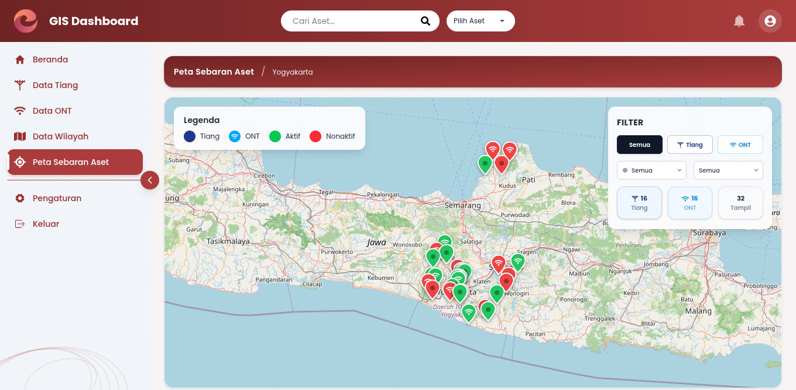
</p>

---

### Form Tambah Tiang

Form Tambah Tiang digunakan untuk memasukkan data aset Tiang baru ke dalam sistem. Form mencakup informasi identitas Tiang, wilayah, area, deskripsi, foto, koordinat lokasi, petugas, serta status aset.

<p align="center">
  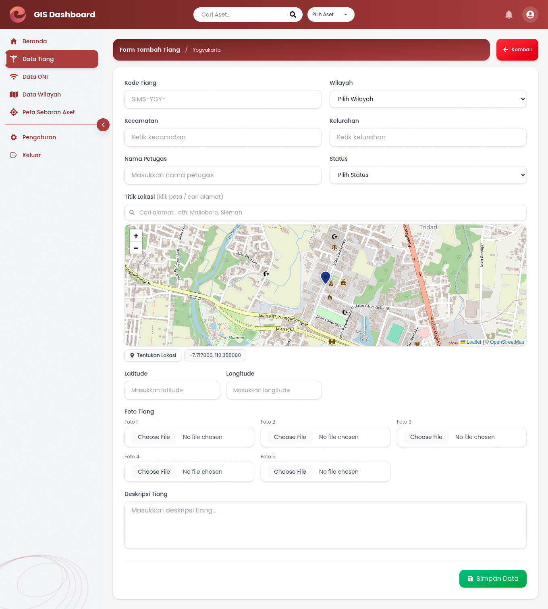
</p>

---

### Edit Tiang

Form Edit Tiang digunakan untuk memperbarui data Tiang yang sudah tersimpan di dalam sistem.

<p align="center">
  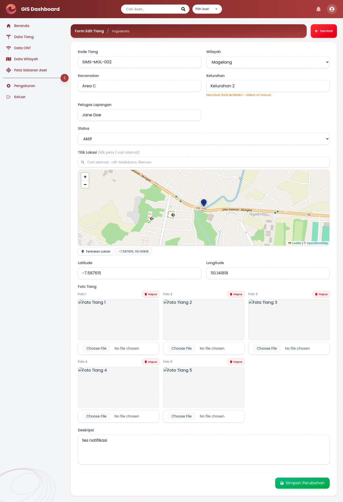
</p>

> **Catatan:** Form Tambah ONT dan Edit ONT memiliki tampilan dan struktur form yang hampir sama dengan form pengelolaan Tiang, dengan penyesuaian field sesuai kebutuhan data ONT.

---

### Form Tambah Wilayah

Form Tambah Wilayah digunakan untuk memasukkan data wilayah baru ke dalam sistem. Form mencakup informasi nama wilayah dan kode wilayah.

<p align="center">
  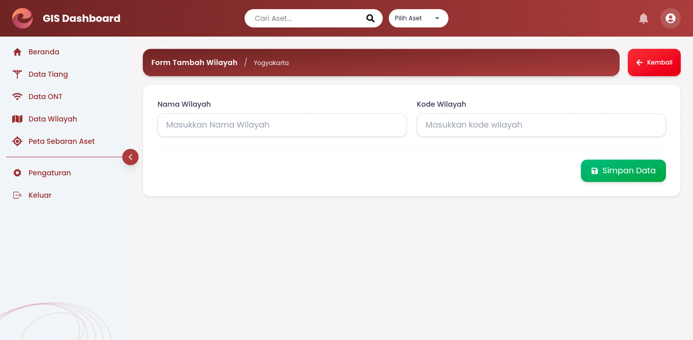
</p>

---

### Notifikasi

Halaman Notifikasi digunakan untuk menampilkan informasi atau pemberitahuan terkait aktivitas dan kondisi data dalam sistem.

<p align="center">
  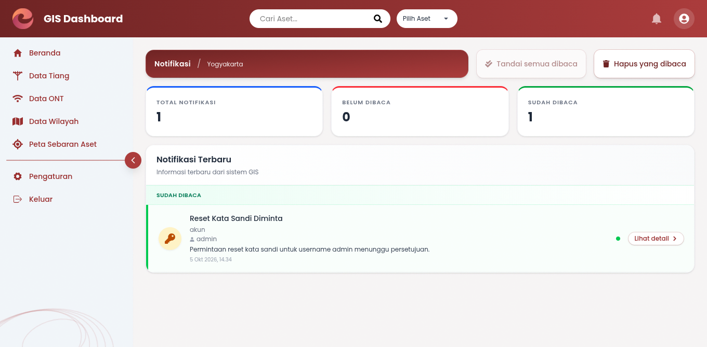
</p>

---

### Detail Notifikasi

Halaman Detail Notifikasi digunakan untuk melihat informasi notifikasi secara lebih lengkap.

<p align="center">
  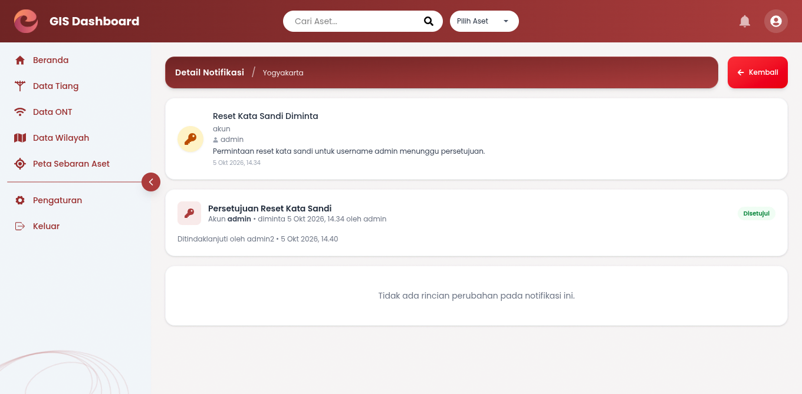
</p>

---

### Pengaturan

Halaman Pengaturan digunakan untuk mengatur konfigurasi yang berkaitan dengan wilayah operasi sistem.

<p align="center">
  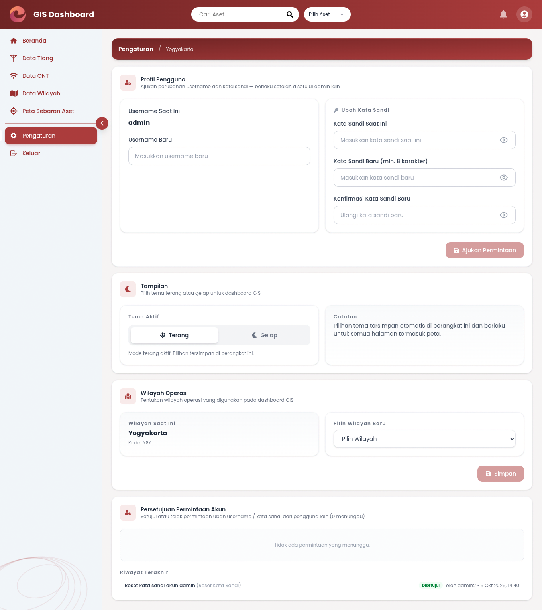
</p>

---

### Lupa Password

Halaman Lupa Password dapat dibuka tanpa login melalui tautan "Lupa password?" di halaman Login. Pengguna mengisi username terdaftar dan kata sandi baru, lalu permintaan menunggu persetujuan admin di kartu **Persetujuan Reset Kata Sandi** pada halaman Pengaturan (atau langsung dari Detail Notifikasi terkait) sebelum berlaku.

---

### Tech Stack
<p align="center">


</p>

### Contributor

Aditya Ammar Al Haqqi

Luthfi Fajar Prasetyo
